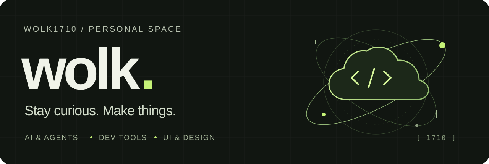

  <picture>
    <source media="(max-width: 600px)" srcset="./assets/wolk-banner-mobile.svg" />
    
  </picture>

  <a href="https://github.com/wolk1710?tab=repositories">Repositories</a>
  &nbsp; / &nbsp;
  <a href="https://github.com/wolk1710?tab=stars">Starred finds</a>
  &nbsp; / &nbsp;
  <a href="https://app.daily.dev/wolk1710">daily.dev</a>

## Hey, I'm Wolk 👋

Curious about **AI agents**, **useful developer tools**, and **thoughtful interfaces**.  
This is my corner of GitHub — a place for ideas, discoveries, and whatever comes next.

### What catches my attention

<table>
  <tr>
    <td width="33%" valign="top">
      01 / EXPLORE
      <h3>AI &amp; agents</h3>
      
New ways to think, build, and work with code.

    </td>
    <td width="33%" valign="top">
      02 / SIMPLIFY
      <h3>Developer tools</h3>
      
Less friction. More room for the interesting stuff.

    </td>
    <td width="33%" valign="top">
      03 / REFINE
      <h3>UI &amp; design</h3>
      
The small details that make software feel right.

    </td>
  </tr>
</table>

  
Take a look at my developer card

   
  

---

Explore a little. Learn something. Come back curious.

